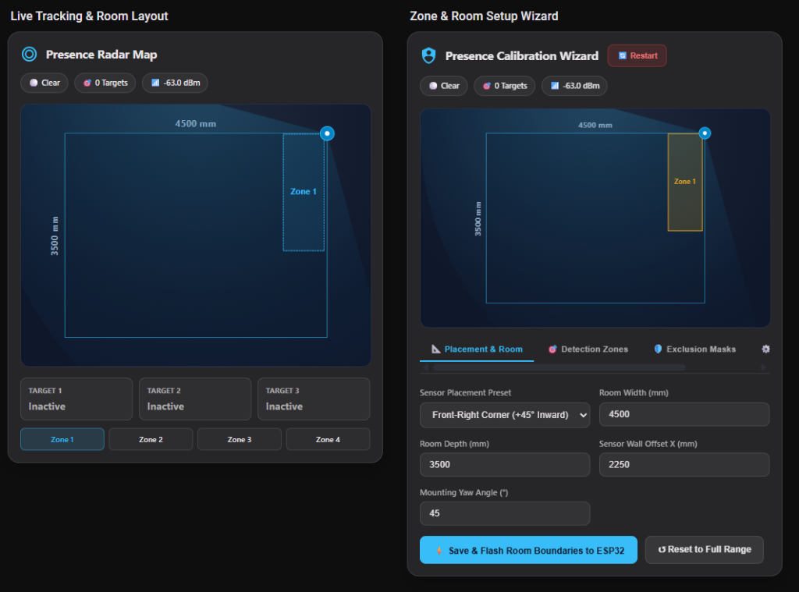

# 📡 ESPHome mmWave Radar Suite for Home Assistant

[](https://my.home-assistant.io/redirect/hacs_repository/?owner=bb12ett&repository=esphome-radar-suite&category=plugin)
[](https://github.com/hacs/default)
[](https://esphome.io)
[](https://www.home-assistant.io)
[](LICENSE)

An all-in-one, high-precision mmWave radar visualization and onboarding suite for **Home Assistant** and **ESPHome HLK-LD2450**.

Eliminate brittle 200-line Plotly YAML configurations and third-party phone apps. This suite provides real-time target tracking, architectural room boundary modeling with true mounting angle rotation, a walk-in auto-calibration wizard, manual coordinate entry with live map feedback, and hardware exclusion masks in a single, lightweight, zero-dependency bundle.

<p align="center">
  
</p>

---

## 🌟 Key Features

### 1. 🎯 Real-Time Radar Map Card (`custom:radar-map-card`)
- **60fps Native SVG Visualization**: Smoothly animates up to 3 simultaneous targets with speed, distance vectors, and motion trails.
- **Architectural Room Coordinates**: Visualizes exact room width and depth with metric dimension labels.
- **120° Physical Beam Angle**: Accurately renders physical radar coverage extending beyond walls.
- **Corner & Offset Mount Geometry**: Automatically rotates and offsets targets and zones relative to the sensor’s wall offset and mounting yaw angle ($\theta$).
- **Dual Display Modes**:
  - `full`: Live radar map, active target telemetry cards (speed/distance), and zone occupancy badges.
  - `minimal`: Clean, distraction-free radar map designed for overview dashboards or wall tablets.
- **Dynamic Auto-Discovery**: Automatically discovers all LD2450 sensors in Home Assistant without manual YAML entity mapping.

### 2. 🛠️ Presence Calibration & Onboarding Suite (`custom:radar-calibration-card`)
- **Persistent Live Viewfinder**: Real-time room map is pinned at the top across **all tabs**, giving instant visual feedback while editing.
- **Walk-in Auto-Calibration**: Walk to Corner 1 $\rightarrow$ Click **Capture Corner 1** $\rightarrow$ Walk to Corner 2 $\rightarrow$ Click **Capture Corner 2 & Save**. The card calculates the bounding box and writes directly to ESP32 NVRAM.
- **Manual Coordinate Entry & Nudges**: Direct numeric inputs for `X1`, `Y1`, `X2`, `Y2`, and `Angle (°)`, with quick $\pm50\text{mm}$ and $\pm5^\circ$ nudge buttons.
- **Live Typing Feedback**: Typing new coordinates instantly moves and rotates the zone polygon on the map before saving.
- **Hardware Exclusion Masks**: Configure the LD2450's hardware exclusion zones (ceiling fans, curtains) and view them rendered on the map as dashed red boundary polygons.
- **Mobile Keyboard Preservation**: Designed with single-render state management so high-frequency 10Hz telemetry updates never close the mobile virtual keyboard or drop text focus.

---

## 🚀 Installation

### Option 1: One-Click Install via My Home Assistant (Recommended)

[](https://my.home-assistant.io/redirect/hacs_repository/?owner=bb12ett&repository=esphome-radar-suite&category=plugin)

### Option 2: Add Custom Repository in HACS
1. Open **HACS** in your Home Assistant UI.
2. Click the three dots in the top right corner $\rightarrow$ **Custom repositories**.
3. Paste the URL of this repository:
   - **Repository**: `https://github.com/bb12ett/esphome-radar-suite`
   - **Type**: `Dashboard` / `Lovelace`
4. Click **Add**, find **ESPHome mmWave Radar Suite**, and click **Download**.
5. Reload your browser.

### Option 3: Manual Installation
1. Download `presence-radar-card.js` from the [`dist/`](dist/presence-radar-card.js) directory.
2. Copy `presence-radar-card.js` to your Home Assistant `config/www/plugins/` directory (create the directory if it doesn't exist).
3. In Home Assistant, navigate to **Settings** $\rightarrow$ **Dashboards** $\rightarrow$ **Resources** (top right menu).
4. Click **Add Resource**:
   - **URL**: `/local/plugins/presence-radar-card.js`
   - **Resource type**: `JavaScript Module`
5. Refresh your browser (**Ctrl+Shift+R**).

---

## 📋 Lovelace Card Configurations

### 1. Minimal Radar Map (Map Only)
```yaml
type: custom:radar-map-card
title: Living Room Radar
device: living_room_presence       # Locks to sensor & hides dropdown. Omit to enable dropdown.
layout_mode: minimal               # "minimal" or "full"
```

### 2. Full Radar Map (With Telemetry & Zone Badges)
```yaml
type: custom:radar-map-card
title: Living Room Radar
device: living_room_presence
layout_mode: full
```

### 3. Whole-House Dynamic Radar Map
```yaml
type: custom:radar-map-card
title: Home Radar Overview
device: ""                         # Setting to "" enables "Select on drop-down"
layout_mode: full
```

### 4. Calibration & Onboarding Suite
```yaml
type: custom:radar-calibration-card
title: Presence Onboarding Suite
device: ""                         # Can onboard any room/sensor in the house from this single card!
```

---

## ⚡ ESPHome Configuration

The repository provides two ready-to-use ESPHome setups located in the [`esphome/`](esphome/) folder:

### 1. Minimal Configuration (`ld2450_minimal.yaml`)
For users who want basic target tracking and zone boundaries using the core ESPHome `ld2450` component without custom C++ code.
- [View `esphome/ld2450_minimal.yaml`](esphome/ld2450_minimal.yaml)

### 2. Full Onboarding Package (`ld2450_full.yaml`)
The complete, production-grade package with:
- **Stationary Presence Memory Tracker**: Vanish protection preventing lights from turning off when stationary.
- **One-Touch Walk-In Zone Calibrator**: C++ corner calculation engine.
- **4 Detection Zones & 3 Hardware Exclusion Masks**.
- **Real-time Engine Parameters**: Zone hold times, latch timeouts, and exit trajectory margins.

#### How to include the Full Package:
1. Place [`presence_memory.h`](esphome/presence_memory.h) and [`ld2450_full.yaml`](esphome/ld2450_full.yaml) into your ESPHome directory (e.g. `config/esphome/`).
2. Create your device YAML:
```yaml
substitutions:
  node_name: "living-room-presence"
  friendly_name: "Living Room Presence"
  tx_pin: "GPIO21"      # LD2450 RX
  rx_pin: "GPIO20"      # LD2450 TX
  board: "esp32-c3-devkitm-1"

packages:
  radar_base: !include ld2450_full.yaml
```

---

## 📐 Sensor Installation Geometry & Math

When mounting an LD2450 mmWave sensor off-center or in a corner at an angle, target coordinates reported by the chip must be transformed into the room’s frame of reference.

The suite implements real-time spatial transformations:

$$\begin{pmatrix} X_{room} \\ Y_{room} \end{pmatrix} = \begin{pmatrix} S_x \\ S_y \end{pmatrix} + \begin{pmatrix} \cos\theta & \sin\theta \\ -\sin\theta & \cos\theta \end{pmatrix} \begin{pmatrix} X_{sensor} \\ Y_{sensor} \end{pmatrix}$$

Where:
- $S_x = \frac{\text{Room Width}}{2} + \text{Wall Offset X}$
- $S_y = 0$ (Front mounting wall)
- $\theta = \text{Sensor Mounting Yaw Angle}$

This ensures that corner mounts (e.g. $45^\circ$ inward) correctly project detection zones and targets inside the room rather than outside the walls.

---

## 🤖 Built with AI & Human Pair Programming

> [!NOTE]
> While I do write software, this suite was heavily co-developed and engineered using **Antigravity (Gemini 3.8 Flash and 4 Argon)**. From trigonometric spatial coordinate math and high-frequency SVG rendering to mobile-optimized DOM state management and ESPHome C++ tracking engines.

---

## 🤝 Contributing
Contributions, bug reports, and feature requests are welcome! Feel free to submit a Pull Request or open an Issue.

## 📄 License
This project is licensed under the MIT License - see the [LICENSE](LICENSE) file for details.
