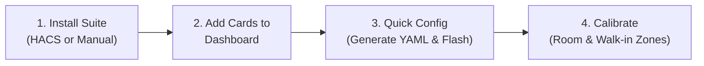
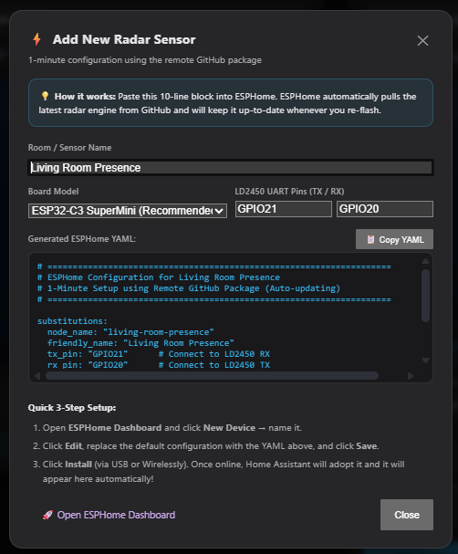

# 📡 ESPHome mmWave Radar Suite for Home Assistant

[](https://my.home-assistant.io/redirect/hacs_repository/?owner=bb12ett&repository=esphome-radar-suite&category=plugin)
[](https://github.com/hacs/default)
[](https://esphome.io)
[](https://www.home-assistant.io)
[](LICENSE)

An all-in-one, high-precision mmWave radar visualization, onboarding, and calibration suite for **Home Assistant** and **ESPHome HLK-LD2450**.

This suite provides real-time multi-target tracking, true architectural room boundaries with mounting rotation, an interactive walk-in calibration wizard, and flexible multi-mode software zones (detection and exclusion) in a clean, zero-dependency package.

<p align="center">
  
</p>

---

## 🚦 End-to-End Setup Guide (4 Simple Steps)

Setting up an LD2450 radar sensor from scratch takes less than 5 minutes:



---

### Step 1: Install the Cards

#### Option A: One-Click via HACS (Recommended)
[](https://my.home-assistant.io/redirect/hacs_repository/?owner=bb12ett&repository=esphome-radar-suite&category=plugin)

1. Click the button above (or open **HACS** $\rightarrow$ top-right 3 dots $\rightarrow$ **Custom repositories**).
2. Add repository: `https://github.com/bb12ett/esphome-radar-suite` with category **Dashboard** (or **Lovelace**).
3. Search for **ESPHome mmWave Radar Suite** and click **Download**.
4. Reload your browser window when prompted.

#### Option B: Manual Installation
1. Download [`presence-radar-card.js`](dist/presence-radar-card.js) from the `dist/` directory.
2. Copy it to your Home Assistant directory under `config/www/plugins/presence-radar-card.js`.
3. In Home Assistant, go to **Settings** $\rightarrow$ **Dashboards** $\rightarrow$ top-right 3 dots $\rightarrow$ **Resources**.
4. Click **Add Resource**, set URL to `/local/plugins/presence-radar-card.js`, and select **JavaScript Module**.
5. Hard-refresh your browser (`Ctrl + F5` or `Cmd + Shift + R`).

---

### Step 2: Add Cards to Your Dashboard

1. Open any Home Assistant dashboard and enter edit mode (**Edit Dashboard** $\rightarrow$ **Add Card**).
2. Choose **Manual Card** at the bottom (or search for `custom:radar-map-card`).
3. We recommend adding two cards side-by-side or stacked:
   * **The Visualizer**: `custom:radar-map-card` for live multi-target tracking.
   * **The Calibration & Setup Suite**: `custom:radar-calibration-card` for room geometry and zone setup.

```yaml
# 1. Live Tracking Visualizer
type: custom:radar-map-card
title: Room Live Radar
layout_mode: full      # "full" includes target telemetry & zone badges; "minimal" is map-only

# 2. Calibration & Setup Card
type: custom:radar-calibration-card
title: Radar Calibration & Setup
```

> [!TIP]
> Leaving `device: ""` omitted or empty enables the **Device Dropdown Selector** at the top of the card. This allows a single card to switch between any radar sensor in your home!

---

### Step 3: Quick Config Guide (Generate YAML & Flash)

If no radar sensors are detected yet, both cards automatically display an empty onboarding card with a **`⚡ Quick Setup Guide & YAML Generator`** button:

<p align="center">
  
</p>

1. Click **`⚡ Quick Setup Guide & YAML Generator`** on either card (or select **`➕ Add New Sensor...`** from the device dropdown at any time).
2. Fill out the 3 fields in the wizard dialog:
   * **Sensor Friendly Name**: e.g., `Living Room Presence` (the wizard automatically creates `node_name: living-room-presence`).
   * **Board Model**: Select your ESP32 board (`ESP32-C3 SuperMini`, `Standard ESP32 (esp32dev)`, or `D1 Mini ESP32`).
   * **UART Pins**: Specify your TX and RX GPIO pins connected to the LD2450 (e.g., `GPIO21` TX and `GPIO20` RX).
3. Click **`📋 Copy YAML`**. The wizard automatically generates the complete 10-line auto-updating package configuration:
   ```yaml
   substitutions:
     node_name: "living-room-presence"
     friendly_name: "Living Room Presence"
     tx_pin: "GPIO21"      # Connect to LD2450 RX
     rx_pin: "GPIO20"      # Connect to LD2450 TX
     board: "esp32-c3-devkitm-1"

   packages:
     radar_suite: github://bb12ett/esphome-radar-suite/esphome/ld2450_full.yaml@main
   ```
4. Click **`🚀 Open ESPHome Dashboard`** directly from the wizard dialog:
   * Click **`+ New Device`**, paste your YAML, and click **Install** (USB initial flash or OTA).
5. **Accept Device in Home Assistant**:
   * Once your ESP32 connects to WiFi, Home Assistant will automatically discover it: *"Discovered new device: ESPHome"*.
   * Click **Configure** $\rightarrow$ **Submit**.
   * Return to your dashboard — the card will immediately auto-discover and load your new sensor!

---

### Step 4: Calibrate Room Geometry & Detection Zones

Open the **`custom:radar-calibration-card`** for your sensor. Calibration is organized into **3 intuitive tabs**:

#### 1. Tab 1: 📐 Placement & Room
* **Room Dimensions**: Enter your physical room measurements in millimeters:
  * **Room Width (mm)** (e.g. `4000`)
  * **Room Depth (mm)** (e.g. `5000`)
* **Sensor Placement Preset**:
  * **Center Wall ($0^\circ$)**: Mounted centered along a wall facing forward into the room.
  * **Front-Left Corner ($-45^\circ$ Inward)**: Mounted in the front-left corner angled inward diagonally.
  * **Front-Right Corner ($+45^\circ$ Inward)**: Mounted in the front-right corner angled inward diagonally.
  * **Left Corner Flat ($0^\circ$)**: Mounted in left corner facing straight ahead.
  * **Right Corner Flat ($0^\circ$)**: Mounted in right corner facing straight ahead.
  * **Custom Offset & Yaw**: Adjust wall offset and mounting yaw freely for irregular rooms.
* **Enclosure Orientation**: Toggle **Upside-Down Mount (Flip X-Axis)** if your enclosure or PCB is mounted inverted.
* Click **`⚡ Save & Flash Room Boundaries to ESP32`**. The live radar viewfinder will instantly transform to match your physical room layout!

#### 2. Tab 2: 🎯 Multi-Mode Zones
Define detection and exclusion zones without typing coordinates using the walk-in stepper:
1. Click **`➕ Add Zone`** (supports up to 10 independent dynamic zones).
2. Walk to the **first corner** of your furniture or area (e.g., front-left of sofa or bed) and watch your target dot in the live viewfinder.
3. Click **`📍 Capture Corner 1`**.
4. Walk to the **opposite diagonal corner** (e.g., back-right of sofa or bed).
5. Click **`💾 Capture Corner 2 & Save`**.
6. Select your **Zone Type**:
   * 🟢 **Detection Zone**: Triggers room occupancy, counts occupants, and maintains stationary presence.
   * 🔴 **Exclusion Mask**: Software filter that completely ignores moving inanimate objects (ceiling fans, fluttering curtains, robot vacuums) within that box so they never falsely trigger room occupancy.
7. *(Optional)* Fine-tune coordinates with quick nudge buttons ($\pm50\text{mm}$, $\pm5^\circ$) or direct inputs (`X1`, `Y1`, `X2`, `Y2`, `Angle`).
8. To remove or collapse unused zones in Home Assistant, click **`🗑️ Disable`**.

#### 3. Tab 3: ⚙️ Engine & Sensitivity
Fine-tune radar filtering, latching, and timeouts:
* **Maximum Detection Distance (mm)**: Ignores reflections, doorways, or false targets beyond this distance.
* **Presence Timeout (s)**: Seconds to maintain room presence after all motion disappears.
* **Zone Off Delay (s)**: Seconds to wait before clearing zone occupancy.
* **Stationary Presence Memory (Vanish Protection)**: Checkbox toggle to latch stationary occupants in detection zones even when LD2450 signal energy drops while sitting completely still.
* **Stationary Latch Timeout (min)**: Minutes to preserve latch when stationary target sits or sleeps (default 30m).
* **Exit Trajectory Margin (mm)**: Distance from boundary to immediately release stationary latch when an occupant walks out of the zone.
* **Multi-Target Tracking**: Enable/disable simultaneous tracking for up to 3 people.
* **Hardware Maintenance**: Quick buttons to **`🔄 Restart ESP32`**, **`🔄 Restart Radar Module`**, or **`⚠️ Factory Reset Radar`**.

---

### Step 5: Verify Live Tracking
Switch back to **`custom:radar-map-card`**:
* Walk around the room. You will see your target dot move in real time with velocity vectors, distance telemetry, and active zone status badges illuminating as you cross zone boundaries!

---

## 🌟 Key Features

### 1. 🎯 Real-Time Radar Map Card (`custom:radar-map-card`)
- **Live 2D Room Visualization**: Smoothly tracks up to 3 simultaneous targets with real-time distance, speed, and movement trails.
- **True Room Dimensions**: Enter your room's width and depth to see realistic physical boundaries.
- **Flexible Sensor Placement**: Mount your sensor centered, offset along a wall, or rotated in a corner (e.g. $45^\circ$) — targets and zones automatically align with your room.
- **Dual Display Modes**: Choose between `full` (radar map, live target telemetry, and zone status badges) or `minimal` (clean map only for overview dashboards).
- **Auto-Discovery & Device Dropdown**: Automatically finds and connects to any LD2450 sensor in your Home Assistant setup.

### 2. 🛠️ Presence Calibration Suite (`custom:radar-calibration-card`)
- **Live Viewfinder**: Real-time room map stays pinned at the top across all 3 tabs for instant visual feedback.
- **Walk-in Calibration**: Walk to Corner 1 $\rightarrow$ Click **Capture Corner 1** $\rightarrow$ Walk to Corner 2 $\rightarrow$ Click **Capture Corner 2 & Save**. The card automatically calculates and saves the zone to your sensor.
- **Multi-Mode Zones (Up to 10 Zones)**: Configure up to 10 independent zones. With a single click, set any zone to:
  - 🟢 **Detection Zone**: Tracks room occupants, counts, and maintains stationary presence.
  - 🔴 **Exclusion Mask**: Automatically ignores moving objects like ceiling fans, curtains, or robot vacuums so they don't trigger false occupancy.
- **Dynamic Zones & Clean Device Page**: All 10 zones are disabled by default in Home Assistant. Click **➕ Add Zone** to dynamically enable and configure slots, or click **🗑️ Disable** to reset coordinates and collapse them.
- **Responsive Layout**: Automatically stacks header controls and device selector on narrow/mobile viewports to prevent squashed dropdowns.
- **In-Card Onboarding Wizard**: If no sensors are discovered, an interactive setup screen appears with a 1-click YAML generator. You can also select **➕ Add New Sensor...** from the device dropdown anytime.
- **Manual Coordinate Tuning**: Direct inputs for `X1`, `Y1`, `X2`, `Y2`, and `Angle (°)`, with quick nudge buttons ($\pm50\text{mm}$, $\pm5^\circ$) and live preview before saving.
- **Mobile-Friendly**: Updates smoothly in the background without dropping focus or closing your mobile keyboard.

---

## 📋 Lovelace Card Configurations

### 1. Minimal Radar Map (Clean Map Only)
```yaml
type: custom:radar-map-card
title: Living Room Radar
device: living_room_presence       # Locks to sensor & hides dropdown. Omit to enable dropdown.
layout_mode: minimal               # "minimal" (map only) or "full"
```

### 2. Full Radar Map (With Telemetry & Zone Badges)
```yaml
type: custom:radar-map-card
title: Living Room Radar
device: living_room_presence
layout_mode: full
```

### 3. Whole-House Dynamic Radar Map
```yaml
type: custom:radar-map-card
title: Home Radar Overview
device: ""                         # Setting to "" enables device dropdown selector
layout_mode: full
```

### 4. Calibration & Onboarding Suite
```yaml
type: custom:radar-calibration-card
title: Presence Onboarding Suite
device: ""                         # Calibrate any sensor in your home from this card!
```

---

## ⚡ ESPHome Configuration Reference

The repository provides ready-to-use ESPHome setups designed for zero-friction onboarding:

### 1. ⚡ Remote GitHub Package (Recommended - Auto-updating)
No downloading files or copying directories needed! ESPHome fetches the entire suite directly from GitHub and automatically keeps it up-to-date whenever you compile.

Create a new device in your ESPHome Dashboard and paste this 10-line configuration:

```yaml
substitutions:
  node_name: "living-room-presence"
  friendly_name: "Living Room Presence"
  tx_pin: "GPIO21"      # Connect to LD2450 RX
  rx_pin: "GPIO20"      # Connect to LD2450 TX
  board: "esp32-c3-devkitm-1"

packages:
  radar_suite: github://bb12ett/esphome-radar-suite/esphome/ld2450_full.yaml@main
```

### 2. Manual Offline Package Setup
For users who prefer to store all YAML files locally or run Home Assistant without internet access:
1. Place [`presence_memory.h`](esphome/presence_memory.h) and [`ld2450_full.yaml`](esphome/ld2450_full.yaml) into your ESPHome directory (`config/esphome/`).
2. Create your device YAML:
```yaml
substitutions:
  node_name: "living-room-presence"
  friendly_name: "Living Room Presence"
  tx_pin: "GPIO21"
  rx_pin: "GPIO20"
  board: "esp32-c3-devkitm-1"

packages:
  radar_base: !include ld2450_full.yaml
```

### 3. Minimal Configuration (`ld2450_minimal.yaml`)
For users who want basic tracking using the standard ESPHome component without custom C++ features.
- [View `esphome/ld2450_minimal.yaml`](esphome/ld2450_minimal.yaml)

---

## 📐 Corner & Wall Placement

When mounting your sensor off-center or in a corner at an angle, target coordinates need to translate into your room's layout. 

The suite handles this automatically:
- **Center Mount**: Sensor placed in the middle of a wall pointing into the room.
- **Offset Mount**: Sensor placed anywhere along the wall; targets shift relative to the offset.
- **Corner Mount (e.g. 45°)**: Mount in the corner looking diagonally across the room; both targets and detection zones rotate to stay inside your room boundaries.

---

## 🚀 Automatic Firmware Parity & Update Alerts

The custom cards automatically monitor firmware version parity between Home Assistant and your ESPHome nodes:
- **Version Parity Check**: The cards inspect `sensor.<node>_radar_suite_version` to ensure your node is running the latest configuration architecture.
- **Update Alerts**: If legacy YAML or an outdated version is detected, an alert banner appears directly on the card with detected vs required versions.
- **1-Click Native Update**: Tap **`🚀 Update Firmware in HA`** to trigger Home Assistant's native ESPHome OTA update dialog, jump to the ESPHome Dashboard, or view the 1-minute setup guide.

---

## 🤖 Built with AI & Human Pair Programming

> [!NOTE]
> This suite was developed through collaborative pair programming with **Antigravity**.

---

## 🤝 Contributing
Contributions, bug reports, and feature requests are welcome! Feel free to submit a Pull Request or open an Issue.

## 📄 License
This project is licensed under the MIT License - see the [LICENSE](LICENSE) file for details.
